## Data model diff

4 entities added, 5 entities removed, 263 attributes added, 156 attributes removed, 4 attributes modified, 10 relationships changed.

Warnings

- duplicate key ('', '') in Table Name,Column Name -- kept last occurrence
- duplicate key ('CLAIM_TRANSACTION', 'LOSS_DT') in Table Name,Column Name -- kept last occurrence
- duplicate key ('CONTRACT', 'GROUP_NUMBER') in Table Name,Column Name -- kept last occurrence

### Diagram

```mermaid
erDiagram
    ENTITY["🟢 "] {
        STRING col "🟢 ADDED"
    }
    CLAIM["🟠 CLAIM"] {
        STRING CLAIM_KEY PK
        STRING BRKR_CLM_REF "🟠 MODIFIED Column Data Type: STRING(100) → STRING()"
        STRING CED_CLM_REF "🟠 MODIFIED Column Data Type: STRING(100) → STRING()"
        STRING TRTY_REF_OLD "🟠 MODIFIED Column Data Type: STRING(100) → STRING()"
    }
    CLAIM_CAT["🟠 CLAIM_CAT"] {
        STRING CLAIM_CAT_KEY PK
        STRING CLAIM_KEY "🟢 ADDED"
    }
    CLAIM_DETAIL["🟢 CLAIM_DETAIL"] {
        TIMESTAMP_NTZ_9 ACCIDENT_TIMESTAMP "🟢 ADDED"
        STRING ACTION_CODE "🟢 ADDED"
        TIMESTAMP_NTZ_9 ADVISED_TIMESTAMP "🟢 ADDED"
        TIMESTAMP_NTZ_9 ATTACHMENT_TIMESTAMP "🟢 ADDED"
        STRING AUTHORIZED_BY_NAME "🟢 ADDED"
        BIGINT CATASTROPHE_EVENT_KEY "🟢 ADDED"
        STRING CLAIMANT_CODE "🟢 ADDED"
        BIGINT CLAIMANT_KEY "🟢 ADDED"
        TIMESTAMP_NTZ_9 CLAIM_CLOSED_TIMESTAMP "🟢 ADDED"
        STRING_80 CLAIM_DETAIL_CODE "🟢 ADDED"
        BIGINT CLAIM_DETAIL_KEY PK "🟢 ADDED"
        STRING CLAIM_DETAIL_NAME "🟢 ADDED"
        STRING CLAIM_DETAIL_SEVERITY_CODE "🟢 ADDED"
        STRING CLAIM_DETAIL_STATUS_CODE "🟢 ADDED"
        STRING CLAIM_DETAIL_STATUS_NAME "🟢 ADDED"
        STRING CLAIM_HANDLER_CODE "🟢 ADDED"
        BIGINT CLAIM_HANDLER_KEY "🟢 ADDED"
        BIGINT CLAIM_MASTER_KEY "🟢 ADDED"
        STRING DAMAGE_DESCRIPTION_TEXT "🟢 ADDED"
        TIMESTAMP_NTZ_9 END_TIMESTAMP "🟢 ADDED"
        STRING FIRST_MOVEMENT_LAST_MOVEMENT_CODE "🟢 ADDED"
        STRING HANDLING_BRANCH_CODE "🟢 ADDED"
        STRING_255 INSURED_OBJECT_TEXT "🟢 ADDED"
        VARCHAR_10 IS_DELETED_INDICATOR "🟢 ADDED"
        TIMESTAMP_NTZ_9 LAST_MOVEMENT_TIMESTAMP "🟢 ADDED"
        TIMESTAMP_NTZ_9 LAST_SEEN_TIMESTAMP "🟢 ADDED"
        STRING LAST_UPDATED_UNDERWRITER_NAME "🟢 ADDED"
        TIMESTAMP_NTZ_9 LAST_UPDATE_TIMESTAMP "🟢 ADDED"
        STRING LOSS_AREA_CODE "🟢 ADDED"
        STRING LOSS_AREA_NAME "🟢 ADDED"
        STRING _more "... +15 more"
    }
    CLAIM_TRANSACTION["🟠 CLAIM_TRANSACTION"] {
        STRING CLAIM_TRANSACTION_KEY PK
        STRING CLAIM_KEY PK, FK "🟠 MODIFIED Attribute/Column Is PK: false → true"
        STRING ALAE_CD "🟢 ADDED"
        STRING BRKR_CLM_REF "🟢 ADDED"
        STRING CED_CLM_REF "🟢 ADDED"
        STRING CED_CLOSE_DT "🟢 ADDED"
        STRING CED_SETTL_AMT "🟢 ADDED"
        STRING CITY_NM "🟢 ADDED"
        STRING CLAIMANT "🟢 ADDED"
        STRING CLAIM_CREATE_ID "🟢 ADDED"
        STRING CLAIM_CURR_CD "🟢 ADDED"
        STRING CLAIM_LOB_KEY "🟢 ADDED"
        STRING CLAIM_NO_OLD "🟢 ADDED"
        STRING CLAIM_RPT_OFC_CD "🟢 ADDED"
        STRING CLAIM_STATUS_CD "🟢 ADDED"
        STRING CLAIM_TYPE_CD "🟢 ADDED"
        STRING CLM_FINAL_DISP_CD "🟢 ADDED"
        STRING CLM_NO "🟢 ADDED"
        STRING CLM_POLICY_CD "🟢 ADDED"
        STRING CMS_ID "🟢 ADDED"
        STRING CMS_ISSUE_CO "🟢 ADDED"
        STRING CMS_ISSUE_OFFICE "🟢 ADDED"
        STRING CMS_MANAGER "🟢 ADDED"
        STRING CONTRACT_LAYER_SECTION_LOB_KEY PK, FK "🟢 ADDED"
        STRING COUNTRY_CD "🟢 ADDED"
        STRING COUNTY_CD "🟢 ADDED"
        STRING CREATE_DT "🟢 ADDED"
        STRING DISPUTED_AMT "🟢 ADDED"
        STRING DISPUTED_DT "🟢 ADDED"
        STRING DISPUTED_REASON_CD "🟢 ADDED"
        STRING DISPUTED_RESOLN_CD "🟢 ADDED"
        STRING DISPUTED_RESOL_AMT "🟢 ADDED"
        STRING DISPUTED_STATUS "🟢 ADDED"
        STRING DISPUTED_TYPE "🟢 ADDED"
        STRING EXAMINER "🟢 ADDED"
        STRING GROSS_SETTL_AMT "🟢 ADDED"
        STRING HAS_POLNO_CHANGED "🟢 ADDED"
        STRING INJURY_CD "🟢 ADDED"
        STRING INSURED "🟢 ADDED"
        STRING LIAB_ASSESS_CD "🟢 ADDED"
        STRING LOC "🟢 ADDED"
        STRING LOSS_DT "🟢 ADDED"
        STRING NATURE_CD "🟢 ADDED"
        STRING NOTICE_DT "🟢 ADDED"
        STRING OCC_NO "🟢 ADDED"
        STRING PARENT_CLM_KEY "🟢 ADDED"
        STRING PAYEE_BR_KEY "🟢 ADDED"
        STRING PLAINTIFF_AGE "🟢 ADDED"
        STRING POL_FRM_DT "🟢 ADDED"
        STRING POL_TO_DT "🟢 ADDED"
        STRING RECOVERY_AMT "🟢 ADDED"
        STRING REINSTATE_TXT "🟢 ADDED"
        STRING RPT_DT "🟢 ADDED"
        STRING SECTION_KEY "🟢 ADDED"
        STRING STATE_CD "🟢 ADDED"
        STRING STATUS_FLG "🟢 ADDED"
        STRING SYSTEM_SOURCE_TXT "🟢 ADDED"
        STRING TOUCH_DT "🟢 ADDED"
        STRING TOUCH_ID "🟢 ADDED"
        STRING TRC_EVENT_CODE "🟢 ADDED"
        STRING TRIAL_YR "🟢 ADDED"
        STRING TRTY_KEY "🟢 ADDED"
        STRING TRTY_OR_FAC_FLG "🟢 ADDED"
        STRING TRTY_REF_OLD "🟢 ADDED"
        STRING UNDERLINE_POL_LMT "🟢 ADDED"
        STRING ZIP_CD "🟢 ADDED"
    }
    CONRACT_LAYER_PARTICIPANT["🟠 CONRACT_LAYER_PARTICIPANT"] {
        STRING CONRACT_LAYER_PARTICIPANT_KEY PK
        STRING CONTRACT_LAYER_KEY FK "🔴 REMOVED"
    }
    CONTRACT["🔴 CONTRACT"] {
        STRING ASSUMED_CEDED_FLG "🔴 REMOVED"
        STRING CONTRACT_KEY PK "🔴 REMOVED"
        STRING_100 CONTRACT_NBR "🔴 REMOVED"
        STRING EFFECTIVE_DT "🔴 REMOVED"
        STRING GROUP_NUMBER "🔴 REMOVED"
        STRING UNDERWRITING_YR "🔴 REMOVED"
    }
    CONTRACT_LAYER["🟠 CONTRACT_LAYER"] {
        STRING CONTRACT_LAYER_KEY PK
        STRING ASSUMED_CEDED_FLG "🟢 ADDED"
        STRING ATTACHMENT_AMT "🟢 ADDED"
        STRING CONTRACT_SUBMISSION_CODE "🟢 ADDED"
        STRING GROUP_NUMBER "🟢 ADDED"
        STRING LAYER_NBR "🟢 ADDED"
        STRING LIMIT_AMT "🟢 ADDED"
        STRING REINSURANCE_SHARE_PCT "🟢 ADDED"
        STRING CONTRACT_KEY FK "🔴 REMOVED"
    }
    CONTRACT_LAYER_SECTION["🟠 CONTRACT_LAYER_SECTION"] {
        STRING CONTRACT_LAYER_SECTION_KEY PK
        STRING CNTRCT_SEC_NAME "🟢 ADDED"
        STRING CNTRCT_SEC_NBR "🟢 ADDED"
        STRING SECTION_LIMIT "🟢 ADDED"
        STRING SECTION_STATUS_CD "🟢 ADDED"
    }
    CONTRACT_SECTION["🔴 CONTRACT_SECTION"] {
        STRING CNTRCT_SEC_NAME "🔴 REMOVED"
        STRING CNTRCT_SEC_NBR "🔴 REMOVED"
        STRING CONTRACT_SECTION_KEY "🔴 REMOVED"
        STRING LOB_CD "🔴 REMOVED"
        STRING SECTION_LIMIT "🔴 REMOVED"
        STRING SECTION_STATUS_CD "🔴 REMOVED"
    }
    CONTRACT_SECTION_LAYER["🔴 CONTRACT_SECTION_LAYER"] {
        STRING ATTACHMENT_AMT "🔴 REMOVED"
        STRING CONTRACT_SECTION_LAYER_KEY "🔴 REMOVED"
        STRING LAYER_NBR "🔴 REMOVED"
        STRING LIMIT_AMT "🔴 REMOVED"
        STRING REINSURANCE_SHARE_PCT "🔴 REMOVED"
    }
    PREMIUM_TRANSACTION["🟢 PREMIUM_TRANSACTION"] {
        STRING ACCT_DOC_SYSTEM_SOURCE_TXT "🟢 ADDED"
        STRING ACCT_DOC_TRTY_REF_OLD "🟢 ADDED"
        DATE ACCT_FROM_DT "🟢 ADDED"
        DATE ACCT_TO_DT "🟢 ADDED"
        INT ACCT_YR "🟢 ADDED"
        DATE ACTIVE_DT "🟢 ADDED"
        DECIMAL_38_2 ANNUITIES_RESERVE "🟢 ADDED"
        STRING ASSUMED_CEDED_FLG "🟢 ADDED"
        STRING AUTO_BOOKED_FLG "🟢 ADDED"
        STRING BAD_DEBT_FLG "🟢 ADDED"
        DATE BAD_DEBT_REG_DT "🟢 ADDED"
        DATE BALANCE_DT "🟢 ADDED"
        INT BATCH_ID "🟢 ADDED"
        STRING BRKR_REF "🟢 ADDED"
        DECIMAL_38_2 BROKERAGE "🟢 ADDED"
        STRING CASH_APPL_NO "🟢 ADDED"
        DECIMAL_38_2 CASH_LOSS_ADV_AMT "🟢 ADDED"
        DECIMAL_38_2 CASH_LOSS_REFUND "🟢 ADDED"
        INT CASH_OPER_ID "🟢 ADDED"
        INT CEDED_CERT_KEY "🟢 ADDED"
        INT CEDED_TRTY_KEY "🟢 ADDED"
        DECIMAL_38_2 COMM "🟢 ADDED"
        STRING COMMENTS "🟢 ADDED"
        STRING CONTRACT_LAYER_KEY FK "🟢 ADDED"
        DATE CREATE_DT "🟢 ADDED"
        INT CREATE_ID "🟢 ADDED"
        STRING CURR_CD "🟢 ADDED"
        DECIMAL_38_2 DAC_ASSETS "🟢 ADDED"
        DECIMAL_38_2 DEFERRED_COMM_AMT "🟢 ADDED"
        DECIMAL_38_2 DEF_PREM_REL "🟢 ADDED"
        STRING _more "... +105 more"
    }
    PREMIUM_TRANSACTION_DETAIL["🔴 PREMIUM_TRANSACTION_DETAIL"] {
        DECIMAL_38_2 ANNUITIES_RESERVE "🔴 REMOVED"
        DECIMAL_38_2 BROKERAGE "🔴 REMOVED"
        DECIMAL_38_2 CASH_LOSS_ADV_AMT "🔴 REMOVED"
        DECIMAL_38_2 CASH_LOSS_REFUND "🔴 REMOVED"
        DECIMAL_38_2 COMM "🔴 REMOVED"
        DECIMAL_38_2 DAC_ASSETS "🔴 REMOVED"
        DECIMAL_38_2 DEFERRED_COMM_AMT "🔴 REMOVED"
        DECIMAL_38_2 DEF_PREM_REL "🔴 REMOVED"
        DECIMAL_38_2 DEF_PREM_WTH "🔴 REMOVED"
        INT DOC_KEY "🔴 REMOVED"
        INT DOC_NO "🔴 REMOVED"
        DECIMAL_38_2 FIRE_PREVENT_FUND "🔴 REMOVED"
        DECIMAL_38_2 FUNDS_REL_LOSS "🔴 REMOVED"
        DECIMAL_38_2 FUNDS_REL_PREM "🔴 REMOVED"
        DECIMAL_38_2 FUNDS_WTH_LOSS "🔴 REMOVED"
        DECIMAL_38_2 FUNDS_WTH_PREM "🔴 REMOVED"
        DECIMAL_38_2 GROSS_PREM "🔴 REMOVED"
        DECIMAL_38_2 INT_FUNDS_GROSS "🔴 REMOVED"
        DECIMAL_38_2 INT_FUNDS_WTH "🔴 REMOVED"
        DECIMAL_38_2 LAE "🔴 REMOVED"
        DECIMAL_38_2 LOSS_PD "🔴 REMOVED"
        DECIMAL_38_2 LOSS_REFUND "🔴 REMOVED"
        DECIMAL_38_2 MATH_RESERVE "🔴 REMOVED"
        DECIMAL_38_2 NO_CLM_REBATE "🔴 REMOVED"
        DECIMAL_38_2 NO_CLM_REBATE_RSRV "🔴 REMOVED"
        DECIMAL_38_2 OS_LAE "🔴 REMOVED"
        DECIMAL_38_2 OS_LOSSES "🔴 REMOVED"
        DECIMAL_38_2 OTHER_RETURN_PREM "🔴 REMOVED"
        DECIMAL_38_2 OVERRIDER_COMM_AMT "🔴 REMOVED"
        DECIMAL_38_2 PFT_COMM_PD "🔴 REMOVED"
        STRING _more "... +35 more"
    }
    PREMIUM_TRANSACTION_HEADER["🔴 PREMIUM_TRANSACTION_HEADER"] {
        DATE ACCT_FROM_DT "🔴 REMOVED"
        DATE ACCT_TO_DT "🔴 REMOVED"
        INT ACCT_YR "🔴 REMOVED"
        DATE ACTIVE_DT "🔴 REMOVED"
        STRING ASSUMED_CEDED_FLG "🔴 REMOVED"
        STRING AUTO_BOOKED_FLG "🔴 REMOVED"
        STRING BAD_DEBT_FLG "🔴 REMOVED"
        DATE BAD_DEBT_REG_DT "🔴 REMOVED"
        DATE BALANCE_DT "🔴 REMOVED"
        INT BATCH_ID "🔴 REMOVED"
        STRING BRKR_REF "🔴 REMOVED"
        STRING CASH_APPL_NO "🔴 REMOVED"
        INT CASH_OPER_ID "🔴 REMOVED"
        INT CEDED_CERT_KEY "🔴 REMOVED"
        INT CEDED_TRTY_KEY "🔴 REMOVED"
        STRING COMMENTS "🔴 REMOVED"
        STRING CONTRACT_LAYER_KEY FK "🔴 REMOVED"
        DATE CREATE_DT "🔴 REMOVED"
        INT CREATE_ID "🔴 REMOVED"
        STRING CURR_CD "🔴 REMOVED"
        INT DOC_NO "🔴 REMOVED"
        STRING DOC_TYPE_CD "🔴 REMOVED"
        DATE DUE_DT "🔴 REMOVED"
        DATE EXPORT_APPROVAL1_DT "🔴 REMOVED"
        STRING EXPORT_APPROVAL1_FLG "🔴 REMOVED"
        INT EXPORT_APPROVAL1_ID "🔴 REMOVED"
        DATE EXPORT_APPROVAL2_DT "🔴 REMOVED"
        STRING EXPORT_APPROVAL2_FLG "🔴 REMOVED"
        INT EXPORT_APPROVAL2_ID "🔴 REMOVED"
        INT EXPORT_PROCESSOR_ID "🔴 REMOVED"
        STRING _more "... +42 more"
    }
    REF_LOB["🟢 REF_LOB"] {
        STRING ANNL_STMT_KEY "🟢 ADDED"
        STRING LOB_CD "🟢 ADDED"
        STRING LOB_DESC "🟢 ADDED"
        STRING REF_LOB_KEY PK "🟢 ADDED"
        STRING STATUS_FLG "🟢 ADDED"
        DATE TOUCH_DT "🟢 ADDED"
    }
    CLAIM_DIARY["CLAIM_DIARY"] {
        STRING CLAIM_DIARY_KEY PK
    }
    CONTRACT_LAYER_SECTION_LOB["CONTRACT_LAYER_SECTION_LOB"] {
        STRING CONTRACT_LAYER_SECTION_LOB_KEY PK
    }
    CLAIM ||--|| CLAIM_DIARY : "R/87"
    CLAIM ||--|| CLAIM_TRANSACTION : "R/89"
    CLAIM ||--|| CLAIM_TRANSACTION : "🟢 NEW R/96"
    CLAIM_CAT ||--|| CLAIM : "R/92"
    CONTRACT ||--|| CONTRACT_LAYER : "🔴 REMOVED R/82"
    CONTRACT_LAYER ||--|| CONRACT_LAYER_PARTICIPANT : "🔴 REMOVED R/85"
    CONTRACT_LAYER ||--|| CONTRACT_LAYER_SECTION : "🔴 REMOVED R/83"
    CONTRACT_LAYER ||--|| CONTRACT_LAYER_SECTION : "🟢 NEW R/94"
    CONTRACT_LAYER ||--|| PREMIUM_TRANSACTION : "🟢 NEW R/93"
    CONTRACT_LAYER ||--|| PREMIUM_TRANSACTION_HEADER : "🔴 REMOVED R/90"
    CONTRACT_LAYER_SECTION ||--|| CONTRACT_LAYER_SECTION_LOB : "R/84"
    CONTRACT_LAYER_SECTION_LOB ||--|| CLAIM_TRANSACTION : "🟢 NEW R/97"
    PREMIUM_TRANSACTION_HEADER ||--|| PREMIUM_TRANSACTION_DETAIL : "🔴 REMOVED R/91"
    REF_LOB ||--|| PREMIUM_TRANSACTION : "🟢 NEW R/95"
```

### Changes

| Entity | Attribute | Change type | Old | New |
|---|---|---|---|---|
|  | — | 🟢 ENTITY ADDED |  |  |
| CLAIM_DETAIL | — | 🟢 ENTITY ADDED |  |  |
| PREMIUM_TRANSACTION | — | 🟢 ENTITY ADDED |  |  |
| REF_LOB | — | 🟢 ENTITY ADDED |  |  |
| CONTRACT | — | 🔴 ENTITY REMOVED |  |  |
| CONTRACT_SECTION | — | 🔴 ENTITY REMOVED |  |  |
| CONTRACT_SECTION_LAYER | — | 🔴 ENTITY REMOVED |  |  |
| PREMIUM_TRANSACTION_DETAIL | — | 🔴 ENTITY REMOVED |  |  |
| PREMIUM_TRANSACTION_HEADER | — | 🔴 ENTITY REMOVED |  |  |
| CLAIM_CAT | CLAIM_KEY | 🟢 ADDED |  |  |
| CLAIM_TRANSACTION | ALAE_CD | 🟢 ADDED |  |  |
| CLAIM_TRANSACTION | BRKR_CLM_REF | 🟢 ADDED |  |  |
| CLAIM_TRANSACTION | CED_CLM_REF | 🟢 ADDED |  |  |
| CLAIM_TRANSACTION | CED_CLOSE_DT | 🟢 ADDED |  |  |
| CLAIM_TRANSACTION | CED_SETTL_AMT | 🟢 ADDED |  |  |
| CLAIM_TRANSACTION | CITY_NM | 🟢 ADDED |  |  |
| CLAIM_TRANSACTION | CLAIMANT | 🟢 ADDED |  |  |
| CLAIM_TRANSACTION | CLAIM_CREATE_ID | 🟢 ADDED |  |  |
| CLAIM_TRANSACTION | CLAIM_CURR_CD | 🟢 ADDED |  |  |
| CLAIM_TRANSACTION | CLAIM_LOB_KEY | 🟢 ADDED |  |  |
| CLAIM_TRANSACTION | CLAIM_NO_OLD | 🟢 ADDED |  |  |
| CLAIM_TRANSACTION | CLAIM_RPT_OFC_CD | 🟢 ADDED |  |  |
| CLAIM_TRANSACTION | CLAIM_STATUS_CD | 🟢 ADDED |  |  |
| CLAIM_TRANSACTION | CLAIM_TYPE_CD | 🟢 ADDED |  |  |
| CLAIM_TRANSACTION | CLM_FINAL_DISP_CD | 🟢 ADDED |  |  |
| CLAIM_TRANSACTION | CLM_NO | 🟢 ADDED |  |  |
| CLAIM_TRANSACTION | CLM_POLICY_CD | 🟢 ADDED |  |  |
| CLAIM_TRANSACTION | CMS_ID | 🟢 ADDED |  |  |
| CLAIM_TRANSACTION | CMS_ISSUE_CO | 🟢 ADDED |  |  |
| CLAIM_TRANSACTION | CMS_ISSUE_OFFICE | 🟢 ADDED |  |  |
| CLAIM_TRANSACTION | CMS_MANAGER | 🟢 ADDED |  |  |
| CLAIM_TRANSACTION | CONTRACT_LAYER_SECTION_LOB_KEY | 🟢 ADDED |  |  |
| CLAIM_TRANSACTION | COUNTRY_CD | 🟢 ADDED |  |  |
| CLAIM_TRANSACTION | COUNTY_CD | 🟢 ADDED |  |  |
| CLAIM_TRANSACTION | CREATE_DT | 🟢 ADDED |  |  |
| CLAIM_TRANSACTION | DISPUTED_AMT | 🟢 ADDED |  |  |
| CLAIM_TRANSACTION | DISPUTED_DT | 🟢 ADDED |  |  |
| CLAIM_TRANSACTION | DISPUTED_REASON_CD | 🟢 ADDED |  |  |
| CLAIM_TRANSACTION | DISPUTED_RESOLN_CD | 🟢 ADDED |  |  |
| CLAIM_TRANSACTION | DISPUTED_RESOL_AMT | 🟢 ADDED |  |  |
| CLAIM_TRANSACTION | DISPUTED_STATUS | 🟢 ADDED |  |  |
| CLAIM_TRANSACTION | DISPUTED_TYPE | 🟢 ADDED |  |  |
| CLAIM_TRANSACTION | EXAMINER | 🟢 ADDED |  |  |
| CLAIM_TRANSACTION | GROSS_SETTL_AMT | 🟢 ADDED |  |  |
| CLAIM_TRANSACTION | HAS_POLNO_CHANGED | 🟢 ADDED |  |  |
| CLAIM_TRANSACTION | INJURY_CD | 🟢 ADDED |  |  |
| CLAIM_TRANSACTION | INSURED | 🟢 ADDED |  |  |
| CLAIM_TRANSACTION | LIAB_ASSESS_CD | 🟢 ADDED |  |  |
| CLAIM_TRANSACTION | LOC | 🟢 ADDED |  |  |
| CLAIM_TRANSACTION | LOSS_DT | 🟢 ADDED |  |  |
| CLAIM_TRANSACTION | NATURE_CD | 🟢 ADDED |  |  |
| CLAIM_TRANSACTION | NOTICE_DT | 🟢 ADDED |  |  |
| CLAIM_TRANSACTION | OCC_NO | 🟢 ADDED |  |  |
| CLAIM_TRANSACTION | PARENT_CLM_KEY | 🟢 ADDED |  |  |
| CLAIM_TRANSACTION | PAYEE_BR_KEY | 🟢 ADDED |  |  |
| CLAIM_TRANSACTION | PLAINTIFF_AGE | 🟢 ADDED |  |  |
| CLAIM_TRANSACTION | POL_FRM_DT | 🟢 ADDED |  |  |
| CLAIM_TRANSACTION | POL_TO_DT | 🟢 ADDED |  |  |
| CLAIM_TRANSACTION | RECOVERY_AMT | 🟢 ADDED |  |  |
| CLAIM_TRANSACTION | REINSTATE_TXT | 🟢 ADDED |  |  |
| CLAIM_TRANSACTION | RPT_DT | 🟢 ADDED |  |  |
| CLAIM_TRANSACTION | SECTION_KEY | 🟢 ADDED |  |  |
| CLAIM_TRANSACTION | STATE_CD | 🟢 ADDED |  |  |
| CLAIM_TRANSACTION | STATUS_FLG | 🟢 ADDED |  |  |
| CLAIM_TRANSACTION | SYSTEM_SOURCE_TXT | 🟢 ADDED |  |  |
| CLAIM_TRANSACTION | TOUCH_DT | 🟢 ADDED |  |  |
| CLAIM_TRANSACTION | TOUCH_ID | 🟢 ADDED |  |  |
| CLAIM_TRANSACTION | TRC_EVENT_CODE | 🟢 ADDED |  |  |
| CLAIM_TRANSACTION | TRIAL_YR | 🟢 ADDED |  |  |
| CLAIM_TRANSACTION | TRTY_KEY | 🟢 ADDED |  |  |
| CLAIM_TRANSACTION | TRTY_OR_FAC_FLG | 🟢 ADDED |  |  |
| CLAIM_TRANSACTION | TRTY_REF_OLD | 🟢 ADDED |  |  |
| CLAIM_TRANSACTION | UNDERLINE_POL_LMT | 🟢 ADDED |  |  |
| CLAIM_TRANSACTION | ZIP_CD | 🟢 ADDED |  |  |
| CONTRACT_LAYER | ASSUMED_CEDED_FLG | 🟢 ADDED |  |  |
| CONTRACT_LAYER | ATTACHMENT_AMT | 🟢 ADDED |  |  |
| CONTRACT_LAYER | CONTRACT_SUBMISSION_CODE | 🟢 ADDED |  |  |
| CONTRACT_LAYER | GROUP_NUMBER | 🟢 ADDED |  |  |
| CONTRACT_LAYER | LAYER_NBR | 🟢 ADDED |  |  |
| CONTRACT_LAYER | LIMIT_AMT | 🟢 ADDED |  |  |
| CONTRACT_LAYER | REINSURANCE_SHARE_PCT | 🟢 ADDED |  |  |
| CONTRACT_LAYER_SECTION | CNTRCT_SEC_NAME | 🟢 ADDED |  |  |
| CONTRACT_LAYER_SECTION | CNTRCT_SEC_NBR | 🟢 ADDED |  |  |
| CONTRACT_LAYER_SECTION | SECTION_LIMIT | 🟢 ADDED |  |  |
| CONTRACT_LAYER_SECTION | SECTION_STATUS_CD | 🟢 ADDED |  |  |
| CONRACT_LAYER_PARTICIPANT | CONTRACT_LAYER_KEY | 🔴 REMOVED |  |  |
| CONTRACT_LAYER | CONTRACT_KEY | 🔴 REMOVED |  |  |
| CLAIM | BRKR_CLM_REF | 🟠 MODIFIED — Column Data Type | STRING(100) | STRING() |
| CLAIM | CED_CLM_REF | 🟠 MODIFIED — Column Data Type | STRING(100) | STRING() |
| CLAIM | TRTY_REF_OLD | 🟠 MODIFIED — Column Data Type | STRING(100) | STRING() |
| CLAIM_TRANSACTION | CLAIM_KEY | 🟠 MODIFIED — Attribute/Column Is PK | false | true |
| CONTRACT_LAYER → PREMIUM_TRANSACTION | R/93 | 🟢 RELATIONSHIP ADDED |  |  |
| CONTRACT_LAYER → CONTRACT_LAYER_SECTION | R/94 | 🟢 RELATIONSHIP ADDED |  |  |
| REF_LOB → PREMIUM_TRANSACTION | R/95 | 🟢 RELATIONSHIP ADDED |  |  |
| CLAIM → CLAIM_TRANSACTION | R/96 | 🟢 RELATIONSHIP ADDED |  |  |
| CONTRACT_LAYER_SECTION_LOB → CLAIM_TRANSACTION | R/97 | 🟢 RELATIONSHIP ADDED |  |  |
| CONTRACT → CONTRACT_LAYER | R/82 | 🔴 RELATIONSHIP REMOVED |  |  |
| CONTRACT_LAYER → CONTRACT_LAYER_SECTION | R/83 | 🔴 RELATIONSHIP REMOVED |  |  |
| CONTRACT_LAYER → CONRACT_LAYER_PARTICIPANT | R/85 | 🔴 RELATIONSHIP REMOVED |  |  |
| CONTRACT_LAYER → PREMIUM_TRANSACTION_HEADER | R/90 | 🔴 RELATIONSHIP REMOVED |  |  |
| PREMIUM_TRANSACTION_HEADER → PREMIUM_TRANSACTION_DETAIL | R/91 | 🔴 RELATIONSHIP REMOVED |  |  |
