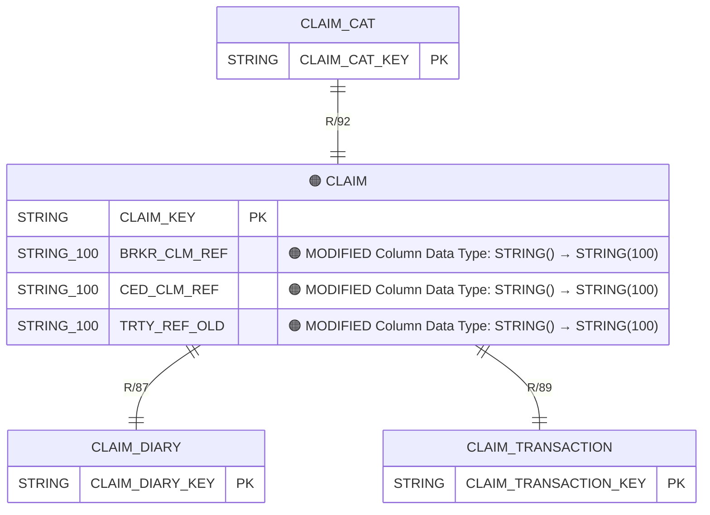

## Data model diff

0 entities added, 0 entities removed, 0 attributes added, 0 attributes removed, 3 attributes modified, 0 relationships changed.

Warnings

- duplicate key ('CONTRACT', 'GROUP_NUMBER') in Table Name,Column Name -- kept last occurrence

### Diagram

### Changes

| Entity | Attribute | Change type | Old | New |
|---|---|---|---|---|
| CLAIM | BRKR_CLM_REF | 🟠 MODIFIED — Column Data Type | STRING() | STRING(100) |
| CLAIM | CED_CLM_REF | 🟠 MODIFIED — Column Data Type | STRING() | STRING(100) |
| CLAIM | TRTY_REF_OLD | 🟠 MODIFIED — Column Data Type | STRING() | STRING(100) |
